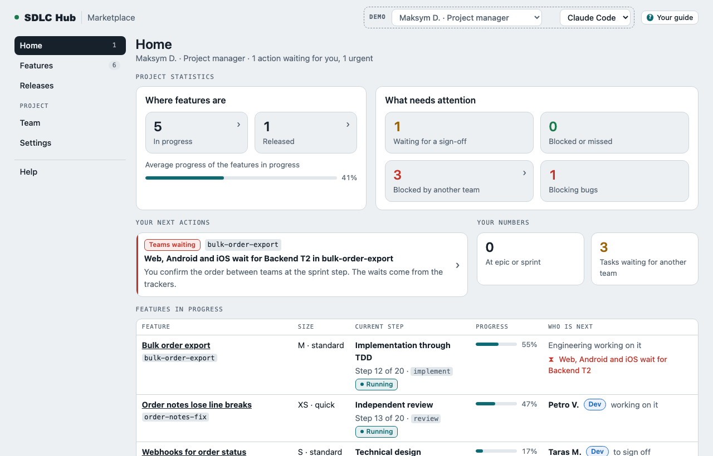
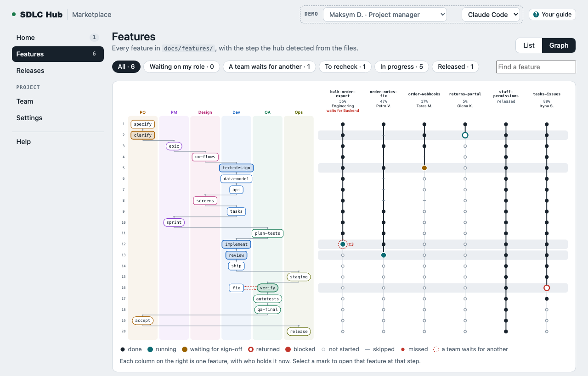
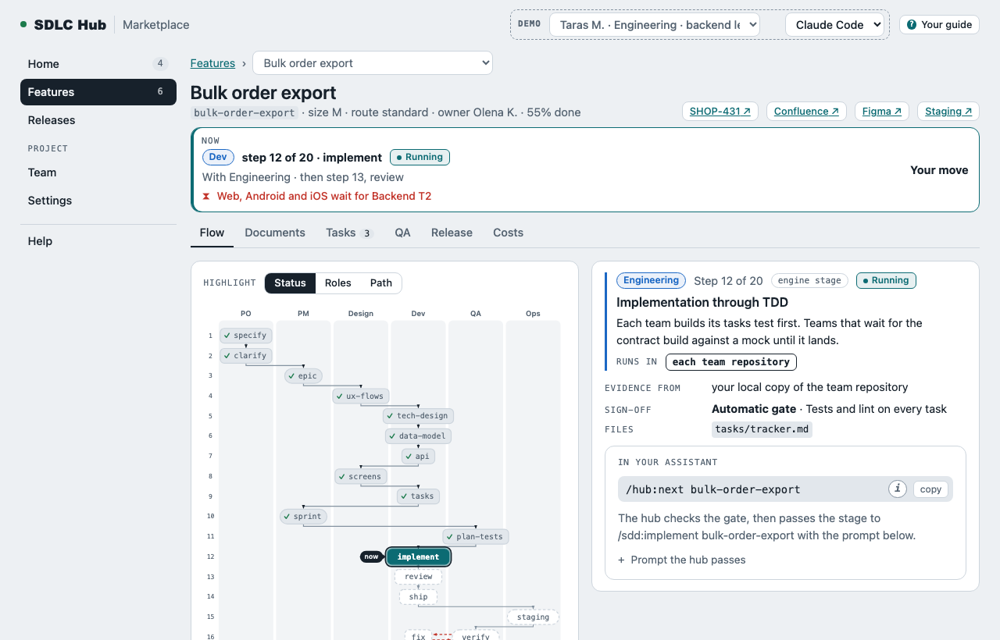
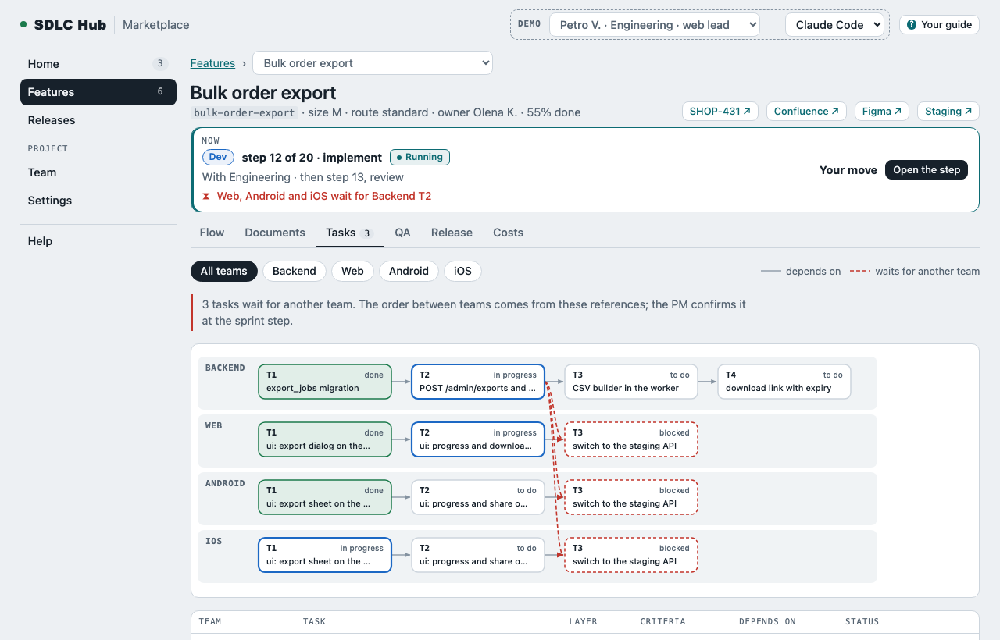
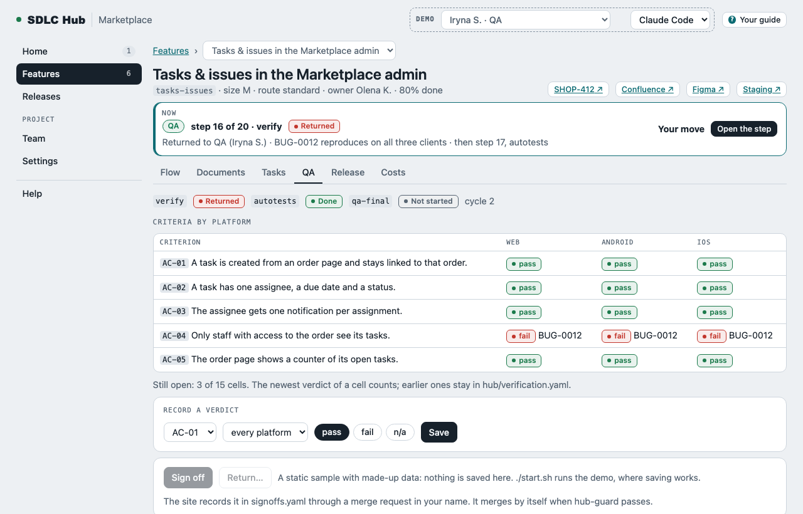
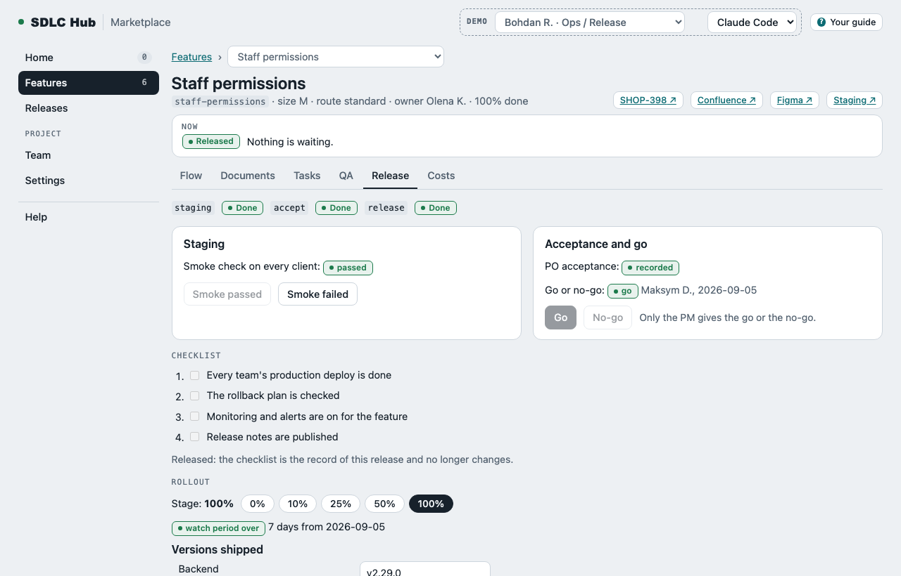
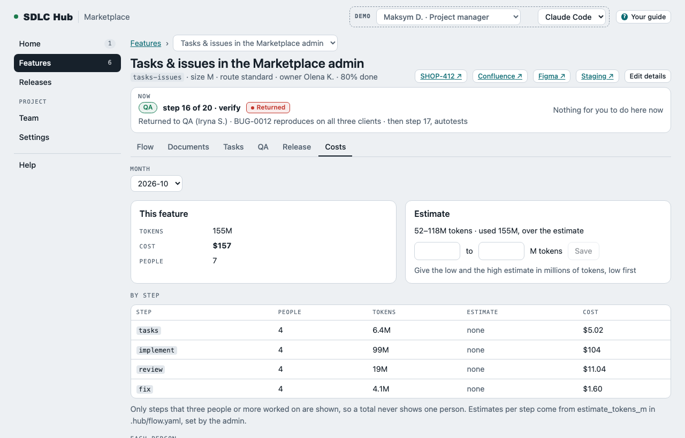
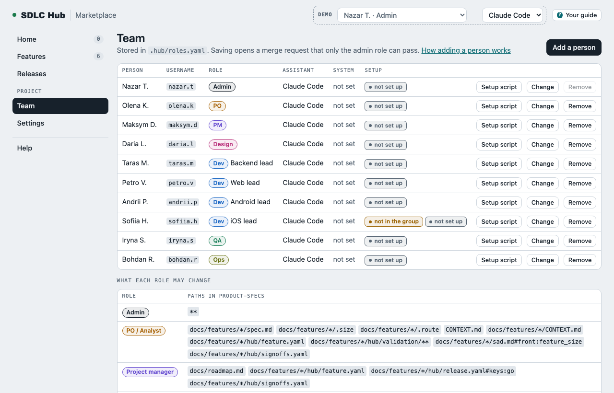
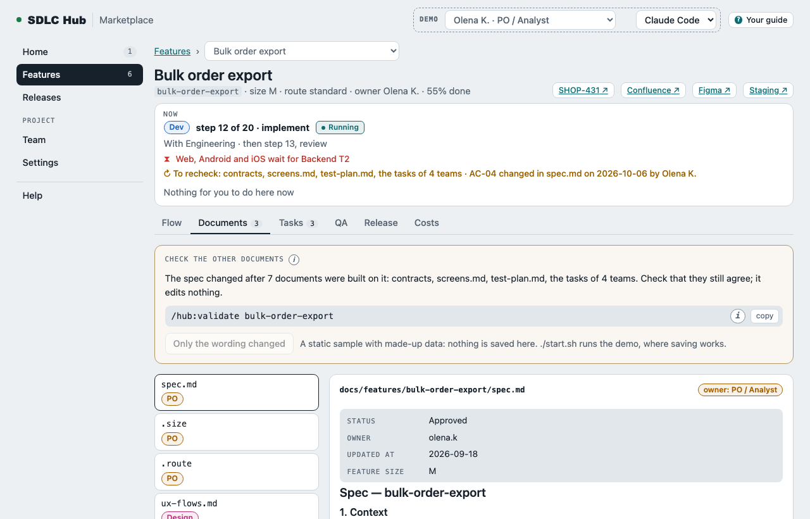
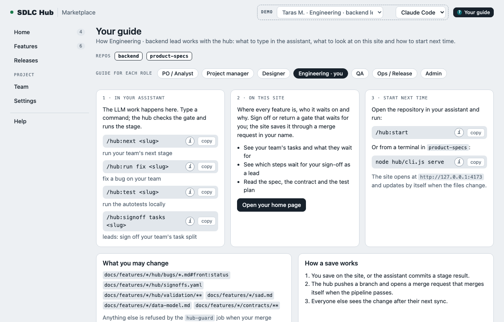

# SDLC Hub

  

> **Not ready for use yet.** SDLC Hub is in development. It installs and runs on a test GitLab and a test GitHub organization, but no team has used it on a real feature yet. Expect changes to the files it writes and the commands it offers.

SDLC Hub shows where every feature is in an AI-assisted, spec-driven development flow, for every role on the team, and lets each person do their part of it. It is a local web site and a plugin for the code assistant. Both live inside the team's `product-specs` git repository, so there is no server to run and no database to keep.

## Why it exists

A team that builds with an AI assistant and a spec-driven engine produces many files per feature: a spec, user flows, a technical design, a data model, an API contract, screens, tasks for several team repositories, a test plan, review records, bugs and release notes. The work is spread across roles and repositories. Questions that should be easy become hard:

- Where is this feature now, and whose move is it?
- Which team is waiting for another team's task, and for how long?
- Is the spec signed off, and did it change after the sign-off?
- What does QA still need before the release, and has every criterion passed on every platform?
- What did this feature cost in tokens, against its estimate?

SDLC Hub answers them from the files themselves. It reads the repositories, works out the step of each feature from the evidence it finds, and shows it to the person whose move it is. Nobody types a status.

## How it works

- **Git is the only database.** Human edits (sign-offs, returns, verdicts, bugs, release records) reach `main` of `product-specs` through merge requests that merge by themselves when a CI job, `hub-guard`, passes. Machine data (team snapshots, test runs, stage events, usage) goes to a `hub-state` branch, which is only a display cache.
- **Twenty steps in six role lanes.** A feature moves from the PO's spec through design, engineering, QA and Ops to release. The current step is derived from files, sign-offs, task trackers, review verdicts and test runs.
- **Roles decide who may change which files.** `hub-guard` enforces it in CI, which works on GitLab Free, where there are no Code Owners. An admin can switch to advisory mode, which warns and merges anyway.
- **The LLM work stays in the assistant.** The plugin gives each role commands such as `/hub:next <feature>`. The hub checks the gate, then hands the stage to the engine. The site never calls an LLM. It hands over the command and the prompt.
- **Everyone runs the same parts on their own machine:** a `hub` command line, a local server on `127.0.0.1:4173`, the web site and the assistant plugin. They are bundled into one file inside `product-specs/hub/`.

## What it looks like

All screenshots show a made-up project: an online marketplace with six features, four engineering teams and ten people.

**Try it without installing anything.** [`docs/sample/index.html`](docs/sample/index.html) is a static copy of the site with the same made-up data. Download or clone the repository and open the file in a browser; it needs no server. Switch the person with the "Demo" control at the top. Saving is off in the sample; `./start.sh` runs the full demo, where saving works (see [Install](#install)).

| | |
|---|---|
|  **Home.** Project statistics, your next actions, and every feature in progress with whose move it is. |  **Features, graph.** Every feature as a track over the twenty steps in six role lanes. |
|  **A feature's flow.** The step it is at, who it waits on, and the command to run in the assistant. |  **Tasks.** Each team's tasks and the waits between teams, from their trackers. |
|  **QA.** Acceptance criteria by platform, bugs, test runs from CI and the final check. |  **Release.** Smoke check, acceptance, go or no-go, checklist, rollout and the watch period. |
|  **Costs.** Tokens and API-equivalent cost by step, against the estimate. Per person only for the admin and the PM. |  **Team.** People, roles, what each role may change, and each person's setup script. |
|  **Documents.** Every document of a feature, its owner, and whether its sign-off is current. |  **Your guide.** What to type and what to look at, for your role. |

More: [features list](docs/screenshots/features.png), [releases](docs/screenshots/releases.png), [settings](docs/screenshots/settings.png), [help](docs/screenshots/help.png), [a phone](docs/screenshots/phone.png).

## SDD, the default engine, and using your own

The hub does not write specs or code itself. Each step that needs an LLM is run by an **engine**: a set of assistant skills that produce the documents of that step.

**The default engine is [SDD](https://github.com/genkovich/sdd)** (`genkovich/sdd`, version 2.3.x), a spec-driven development plugin for Claude Code, Codex and Cursor. Its stages are `specify`, `clarify`, `ux-flows`, `design` and `sequences`, `data-model`, `api`, `screens`, `tasks`, `plan-tests`, `implement`, `review`, `ship` and `fix`. They write files such as `spec.md`, `sad.md`, `tasks.json` and the review records. The hub adds the steps that are not engine work: epic, sprint, staging, verify, autotests, final check, acceptance and release.

The hub talks to the engine through one adapter file, `.hub/engines/sdd.yaml`. For each step it says which engine stage runs it, where its evidence lives, and what counts as done:

```yaml
id: sdd
source: genkovich/sdd
version: "2.3.x"
invoke:
  claude: "/sdd:{stage} {slug}"
  codex:  "$sdd-{stage} {slug}"
  cursor: "/sdd-{stage} {slug}"
steps:
  specify:     { stage: specify, in: specs, done_when: ["file:spec.md", "file:.size", "file:.route"] }
  tech-design: { stages: [design, sequences], in: contract, done_when: ["file:sad.md", "file:adr/*.md", "file:_sequences-log.md | finished:tech-design | route:quick"] }
  implement:   { stage: implement, in: teams, done_when: ["tracker:all-done"] }
  # ... one entry per engine step
```

**To use your own engine:**

1. Add `.hub/engines/<your-engine>.yaml` with the same shape: how to invoke a stage in each assistant, and for each step its stage, `in` (where the evidence is), `done_when` (the evidence) and `skippable_on` (the routes on which it may be skipped). The evidence language covers files (`file:<glob>`), document sections (`section:<file>#<heading>`), sign-offs, the task tracker, review verdicts, merge requests and routes.
2. Set `engine: <your-engine>` in `.hub/config.yaml`.

The hub ships a second engine, **`plain`**, to prove the engine can be swapped. It runs the same steps from plain prompt files in `.hub/engines/plain/`, with no engine plugin. On the demo project, every feature shows the same state with either engine.

**To change what the assistant is told** without changing the engine, add a prompt template for a step in `.hub/prompts/<step>.md`. The placeholders `{slug}`, `{title}`, `{step}`, `{route}` and `{size}` are filled in for the feature.

The full contract is in the specification, [Engine adapter](docs/specification.md#engine-adapter).

## Install

### Try the demo

You need Node.js 22 or newer and git.

```
./start.sh                       # installs, builds, serves the demo project and opens it in the browser
./start.sh --as maksym.d         # the same, as another person
```

`npm start` does the same. The dashed "Demo" control at the top switches between the people:

| Person | Role |
|---|---|
| `nazar.t` | Admin |
| `olena.k` | PO / analyst |
| `maksym.d` | Project manager |
| `daria.l` | Designer |
| `taras.m` | Backend team lead |
| `petro.v` | Web team lead |
| `andrii.p` | Android team lead |
| `sofiia.h` | iOS team lead |
| `iryna.s` | QA |
| `bohdan.r` | Ops / release |

Ctrl+C stops the demo and deletes its temporary folder.

**Things to try:**

- **Saving:** open `returns-portal` as `olena.k` and sign off clarify. Or open `order-webhooks` as `taras.m` and return tech-design with a reason. The save waits a moment while the demo's stand-in for GitLab runs `hub-guard`, then the step moves on.
- **QA and release:** as `iryna.s`, use a feature's QA tab. As `bohdan.r` and `maksym.d`, use its Release tab. `./start.sh --fixture release-walk --as bohdan.r` has one feature at staging that you can take all the way to released.
- **Other projects:** `./start.sh --fixture <name>` opens another demo project, such as `quick-route`, `implement-blocked`, `qa-return-cycle-2` or `no-user-interface` (all in `packages/fixtures/src/cases.ts`).

### Install for a team

The admin runs the setup site once. It asks five screens of questions, checks the host, and installs:

```
npm run build
node packages/cli/dist/cli.mjs init        # npx sdlc-hub init once the package is published
```

Then the admin adds people on the Team page and sends each person a setup script. The script contains no token, key or password. The step-by-step guides cover the tokens and permissions each host needs:

| Guide | For |
|---|---|
| [Install on GitLab](docs/guides/gitlab.md) | The admin: the personal access token (`api` scope), the Owner role, a runner, what Install creates (`HUB_STATE_TOKEN`, `hub-ci`, `HUB_GUARD_TOKEN`, protected `main`) and when to renew the tokens. |
| [Install on GitHub](docs/guides/github.md) | The admin: the organization settings, the fine-grained token and its permissions, the plan, what Install creates (the deploy key and `HUB_STATE_KEY`, the ruleset, the workflows). |
| [People](docs/guides/people.md) | The admin adds a person and sends a setup script, and the person runs it. What each machine needs, and the everyday commands. |
| [Settings](docs/guides/settings.md) | How strict `hub-guard` is (enforce or advisory, and the checks that can be switched off), assistants, headless runs, links, and `hub usage rekey`. |
| [When something changes under your step](docs/guides/changes.md) | Everyone: why a step shows ↻ recheck after the spec, the flows or the contract changed, who answers, and the two answers (run the step again, or No change needed; the PO's Only the wording changed). With diagrams of each flow. |

The same guides are on the site's Help page.

To open the site on an existing `product-specs` checkout: `./start.sh --project <path to product-specs>`. You are the person in `.hub/roles.yaml` who matches your git identity.

### The assistant plugin

Install writes the `hub` plugin into `hub/plugin/` and enables it in `.claude/settings.json`. The setup script registers it on each machine. The commands are:

`start`, `status`, `next`, `run`, `new`, `validate`, `signoff`, `return`, `bug`, `verify`, `test`, `decide`, `release`, `sync` and `doctor`.

Type them as `/hub:<command>` in Claude Code, `$hub-<command>` in Codex and `/hub-<command>` in Cursor. To try the plugin without installing it: `claude --plugin-dir hub/plugin`.

## Common questions

**Is it ready to use?**
Not yet. It installs and works on a test GitLab (CE 19.4) and a test GitHub organization, and its tests pass, but no team has run a real feature through it yet. Codex and Cursor support is written from their documentation and is not yet checked in either tool. See [docs/open-items.md](docs/open-items.md).

**Do we need to run a server?**
No. Each person runs the site on their own machine (`127.0.0.1` only). The state is shared through git: `main` and the `hub-state` branch of `product-specs`.

**Which git hosts work?**
Self-managed GitLab, including the Free tier, and GitHub. On GitHub Free with private repositories, `hub-guard` can only warn, because GitHub Free does not offer the required protection for private repositories. Public repositories, or a Team plan, get full enforcement.

**Does the site call an LLM, or need an API key?**
No. All LLM work happens in your code assistant, with your own subscription. The site shows the command and the prompt to copy. An admin can let the site start the assistant for one read-only task, validating documents after a spec change.

**Do we have to use SDD?**
No. SDD is the default engine, but any engine can be plugged in with one adapter file (see [above](#sdd-the-default-engine-and-using-your-own)). The hub also ships its own small engine, `plain`.

**Does it replace Jira, Confluence or Figma?**
No. Tasks and bugs live in the repositories, and each feature links to its Jira issue, Confluence page, Figma file and staging address. Jira is optional.

**Who can see how much each person spent?**
Only the admin and the PM. Usage records are encrypted per person with `age`. Everyone else sees totals for groups of three people or more, so no total shows one person.

**What stops someone from changing files they should not?**
The `hub-guard` CI job checks every merge request against the roles in `.hub/roles.yaml` before it merges. A merge request cannot change its own check: on GitLab the job's configuration comes from a separate project, and on GitHub the workflow always runs from the default branch.

**Where do tokens and keys go?**
Never into the repository, a setup script or the site. Install stores the host tokens it creates as masked CI variables or secrets. Each person signs in through git's credential manager, and the usage key stays in their system keychain.

**Can it work offline?**
Yes. Saves made offline wait on your machine and go out with the next `node hub/cli.js sync`.

## Documentation

- [docs/specification.md](docs/specification.md): the specification, the source of truth.
- [docs/decisions.md](docs/decisions.md): what was decided and why, by date.
- [docs/open-items.md](docs/open-items.md): what is not done or not verified yet.
- [docs/guides/](docs/guides/): installing on GitLab and GitHub, people, settings, and what happens when something changes under a step.
- [docs/sample/index.html](docs/sample/index.html): the static sample of the site.
- [prototypes/](prototypes/): the clickable prototypes from the design phase.

## Development

### Check it

```
npm test            # unit and integration tests (Vitest)
npm run typecheck
npm run e2e         # build, then walk every page as every person at 1366px and 390px (Playwright)
npm run sample      # rebuild docs/sample/index.html and docs/screenshots/ from the demo
npm run diagrams    # draw the guides' mermaid blocks as SVG for the site, after changing one
```

Run `npx playwright install chromium` once before the first `npm run e2e`.

### Testing against real hosts

Secrets go only in `~/.sdlc-hub-test/` (mode 600), never into the repository.

A local GitLab CE in Docker needs about 4 GB of memory, and 10 minutes for the first start:

```
docker run -d --name sdlc-hub-gitlab -p 8929:8929 -e GITLAB_OMNIBUS_CONFIG="external_url 'http://localhost:8929'" gitlab/gitlab-ce:latest
node e2e/gitlab/bootstrap.mjs      # group shop, owner nazar.t, five repositories, a runner; secrets in ~/.sdlc-hub-test/
npm run test:gitlab                # the install twice, a real hub-report pipeline, and hub-guard at merge
HUB_GITLAB_IT=1 npx playwright test e2e/setup.spec.ts
```

For a throwaway GitHub organization:

1. Create a token as in [the GitHub guide](docs/guides/github.md#2-create-your-fine-grained-token).
2. Put `{"org": "<org>", "token": "<token>"}` in `~/.sdlc-hub-test/github.json`.
3. To include the refusal and advisory tests, add `"people": {"<login>": "<token>"}` with a second member's token. It needs Contents and Pull requests, read and write, on `product-specs`.
4. Run:

```
node e2e/github/bootstrap.mjs      # public product-specs, backend and web-admin, each team with a CI workflow
npm run test:github                # the install twice, saves that merge themselves, hub-report, refusal and advisory mode
```

The PowerShell setup script can be checked in PowerShell on Linux. This checks the script, not Windows itself:

```
docker build -t sdlc-hub-pwsh e2e/pwsh
npm run -s build && HUB_PWSH_IT=1 npx vitest run packages/cli/test/script-run.test.ts
```

### Layout

| Package | What |
|---|---|
| `packages/core` | Data model and validators, the engine adapters, step detection, roles and paths. No I/O. |
| `packages/git` | Read-only view of product-specs: the working tree, the `hub-state` branch, team clones, git authors. |
| `packages/host` | GitLab and GitHub: one adapter, with the host's own words. |
| `packages/install` | The setup site's install, upgrade and removal on each host. |
| `packages/save` | Saves through merge requests, conflicts, and work offline. |
| `packages/plugin` | The assistant plugin: commands, skills and the MCP server. |
| `packages/usage` | Usage records: reading token counts, encrypting them per person, totals. |
| `packages/server` | Loopback-only server: Host and Origin checks, session cookie, REST and server-sent events, the web app. |
| `packages/web` | The site (Preact + Vite). |
| `packages/cli` | The `hub` command line, bundled into one file by esbuild. |
| `packages/fixtures` | The demo project and synthetic fixture repositories. |
| `scripts/` | Builds the static sample and the screenshots. |
| `prototypes/` | The UI reference from the design phase. |
