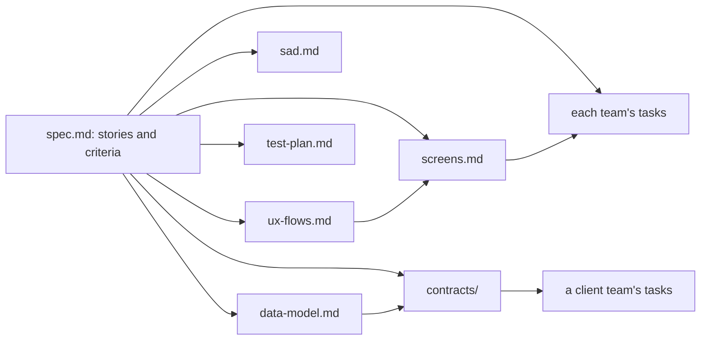
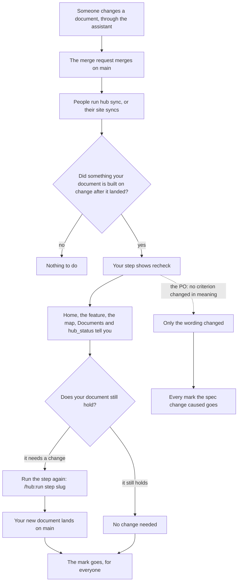
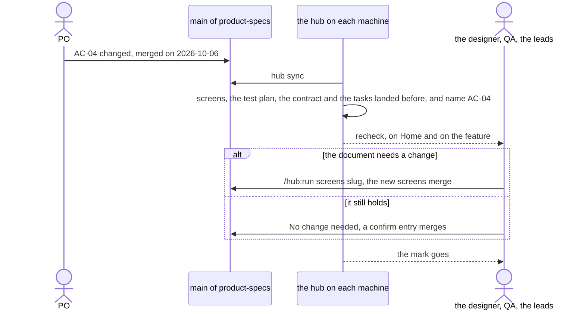
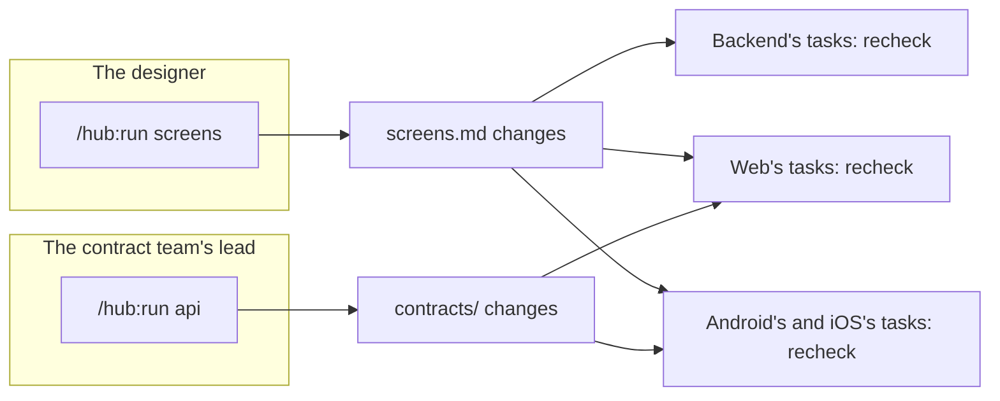
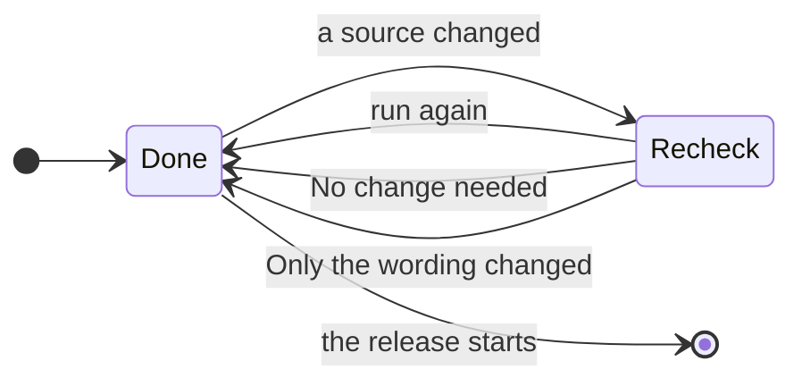

# When something changes under your step

For everyone on the team. A step's document is built on others: the screens on the spec and the flows, each team's tasks on the spec, the screens and the contract. When one of those changes after your document landed, the hub marks your step **↻ recheck** and tells you, until you run the step again or confirm that nothing needs to change.

## What depends on what

Each arrow reads "is built on". A change on the left reaches every document to its right.

| Document | Step | Built on | Who answers |
|---|---|---|---|
| `ux-flows.md` | ux-flows | the spec | the designer |
| `screens.md` | screens | the spec, the flows | the designer |
| `sad.md` | tech-design | the spec | the contract team's lead |
| `data-model.md` | data-model | the spec | the contract team's lead |
| `contracts/` | api | the spec, the data model | the contract team's lead |
| `test-plan.md` | plan-tests | the spec | QA |
| a team's tasks | tasks | the spec, the screens, and for a client team the contract | that team's lead (the team is told) |

## How the hub finds a change

Nobody marks anything by hand. The hub reads the history of `main`:

- **When your document landed.** A merged merge request counts at its merge. A team's tasks live in the team's repository: they count from when the team's `tasks.json` last changed there (hub-report reads it from the repository's history) or when someone of the team last finished the tasks stage, whichever is later; with neither, from when the tasks stage finished or was signed off.
- **What the spec said then, and what it says now, by id.** A heading or a list item that starts with an id owns the text up to the next one: `### AC-04 …`, `- **US-02** …`. An id named inside a sentence is a reference.
- **Which ids your document names.** A changed criterion marks the documents that name it. An added or removed story or criterion marks every document, because each may need to cover it. A document that names no id, such as `sad.md`, is marked only for an added or removed one.
- **The other files as a whole.** A change of the flows marks the screens; of the data model, the contract; of the screens, every team's tasks; of the contract, the client teams' tasks.

A change of spacing is no change. Once the release is under way, nothing is marked: a change then belongs to the next feature.

## What happens next

Where you see it:

- **Home.** What needs attention counts the documents to recheck, and opens the features that have them. Your next actions has one line per document that is yours: what changed, when and by whom.
- **The feature.** The Now box says what is to recheck; when one is yours it says Your move, with a button to the step.
- **The map.** A step to recheck shows ↻ with an amber border, in each of the Status, Roles and Path views.
- **The step.** Its panel says what changed and by whom, with the command to run the step again and **No change needed**.
- **Documents.** The marked documents show needs validation. The PO and the leads see the validation card there.
- **The assistant.** `/hub:status <slug>` lists the steps to recheck and says which are yours.

## The variants

### The PO changes a criterion

The PO runs `/hub:run clarify <slug>`, the spec changes, and the hub saves it as a merge request in the PO's name.

To check every marked document at once, the PO or a lead runs `/hub:validate <slug>`: the assistant reads each document against the spec and reports, document by document, consistent or what conflicts. It edits nothing. After the report it offers No change needed for the documents that are yours and still hold, and, to the PO, Only the wording changed when every document holds.

### The PO only reworded the spec

The hub compares the text under each id, so it cannot tell a reworded criterion from a changed one by itself. It keeps both versions: every recheck card has **What changed in the spec**, with each criterion as it was and as it is now, and the PO sees it open on the feature's Documents. `/hub:validate` also says, for each changed criterion, whether its meaning changed or only its words.

When no criterion changed in meaning, the PO chooses **Only the wording changed** on Documents, or confirms it after `/hub:validate`. Every mark this spec change caused goes at once. A later change of the spec counts again. The assistant's reading never clears a mark on its own: a person confirms.

### The designer changes the screens

The designer runs `/hub:run screens <slug>`. Their own mark on screens goes, and each team's tasks are marked: the screens are what the client teams build.

### The contract team changes the API

The contract team's lead runs `/hub:run api <slug>`. The client teams' tasks are marked; the contract team's own are not, since it wrote the change.

## A step, from done to rechecked and back

A source is anything the step's document is built on. Once the release starts, nothing is marked any more.

## Questions

**I ran the step again and the mark is still there.** The step left the document as it was, so nothing new landed. If the document still holds, choose No change needed.

**Why is my document marked when only the wording changed?** The hub compares the text under each id. Ask the PO to choose Only the wording changed, or confirm your own step.

**Who may choose No change needed?** The owner of the step, as the table above says. The `hub-guard` job refuses it from anyone else. A lead's answer for the tasks counts for their own team only.

**What is recorded?** An entry in the feature's `hub/signoffs.yaml` with `decision: confirm`, your step, the file you checked against and its hash, saved through a merge request in your name. Only the wording changed is the same entry for the step `clarify` with `spec.md`.
